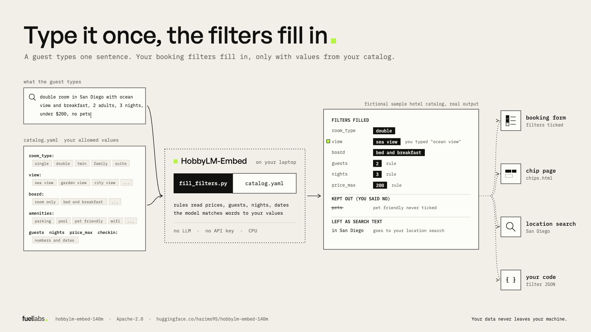

[](https://colab.research.google.com/github/fuellabs-ai/cookbooks/blob/main/type-it-once/walkthrough.ipynb)

# Type it once, the filters fill in



For online stores, hotel booking and travel search.

<sub>Embedding task: matching phrases to a fixed list of values</sub>

A shopper types one sentence, for example "crimson trail shoes under 80,
size 10, waterproof", and the recipe returns a filter object whose values come
only from the catalog's own allowed lists, plus a small HTML page showing the
sentence and its filter chips. It never invents a value, never books anything
and never calls a store API.

## Who this is for

Anyone running a faceted search form on their own site: a shoe store, a hotel
booking page, a rental catalog. Your customers type sentences; your form wants
checkbox values. Also useful for travel search (flights, trains, holiday
rentals): the same rules cover prices, guest counts and dates, and the model
matches free phrases like "seaside" to a fixed list such as "sea view". No
travel example files ship with the cookbook; the hotel example shows the
shape.

## How the work is split

- **Rules (no model):** regex handles numbers, prices, sizes, guest counts
  and nights. A small built-in offline date parser handles dates ("this
  friday", "next weekend", "24 dec", "tomorrow", "tonight"), always relative
  to a base date you pass with `--today` so runs are reproducible.
- **Negation (no model):** before any matching, "no", "not" and "without"
  mask the value words after them (one word, or two when the first word alone
  is not a catalog value, so "no carpet" can never become carpet but
  "not black running shoes" only drops "black"). Case insensitive:
  "no Balcony" works.
- **HobbyLM-Embed (the only model):** matches the remaining phrases to the
  catalog's allowed values ("crimson" to red, "seaside" to sea view).
  `harims95/hobbylm-embed-140m`, revision `ea708cee`,
  `trust_remote_code=True`, unit-norm vectors, dot product, CPU. User phrases
  are embedded with `prompt_name="query"` and the value list with
  `prompt_name="passage"`; plain text was also tried on dev and lost on both
  examples (numbers below), so prompted is the shipped setting.
- **Schema check:** every filled value is validated against the catalog
  before output. Enum values must be in the list, numbers must be in range,
  dates must be ISO. A rule fill the schema refuses (for example "eu size 44"
  against a UK size filter) falls back to search text. The recipe never
  invents a value.
- **Grey chips:** a phrase whose score clears the low threshold but not the
  high one (or whose margin over the runner-up value is too small) becomes a
  grey "check this" chip, never a silent filter. Phrases that match nothing
  stay as plain search text, never dropped. Every word fills at most one
  filter; multi-value filters (features, amenities) can take several.

## Quickstart

```bash
pip install "sentence-transformers>=5" pyyaml
python fill_filters.py "crimson trail shoes under 80, size 10, waterproof" --catalog examples/shoe_store/catalog.yaml
python fill_filters.py "double room with sea view and breakfast under 120 for 2 adults 3 nights" --catalog examples/hotel_rooms/catalog.yaml
python fill_filters.py "double room in San Diego with ocean view and breakfast, 2 adults, 3 nights, under $200, no pets" --catalog examples/hotel_rooms/catalog.yaml
python calibrate.py examples/shoe_store
```

`calibrate.py` sweeps the thresholds on the dev split and writes
`examples/<name>/thresholds.json`, which `fill_filters.py` then picks up
automatically. `--hi`, `--lo`, `--margin` and `--mode` override it. Batch mode
reads a CSV: `python fill_filters.py --queries examples/shoe_store/queries_test.csv
--catalog examples/shoe_store/catalog.yaml --html chips.html`.

## Expected output

Pasted from real runs on CPU (Apple Silicon laptop, Python 3.15,
sentence-transformers 6.3.0). Single sentence, shoe catalog:

```json
{
 "filters": {"price_max": [80], "size_uk": [10], "activity": ["trail"],
             "features": ["waterproof"], "colour": ["red"]},
 "check": [{"phrase": "shoes", "filter": "features", "value": "leather",
            "score": 0.622}],
 "search_text": "shoes",
 "negated": [],
 "rule_fills": [{"filter": "price_max", "value": 80, "rule": "price"},
                {"filter": "size_uk", "value": 10, "rule": "size"}]
}
```

"shoes" matched nothing it could fill, so it stays as search text, and its
runner-up ("leather", 0.62) is offered as a chip, not filled. Single sentence,
hotel catalog:

```json
{
 "filters": {"price_max": [120], "guests": [2], "nights": [3],
             "view": ["sea view"], "room_type": ["double"],
             "board": ["bed and breakfast"]},
 "check": [],
 "search_text": "",
 "negated": [],
 "rule_fills": [{"filter": "price_max", "value": 120, "rule": "price"},
                {"filter": "guests", "value": 2, "rule": "guest count"},
                {"filter": "nights", "value": 3, "rule": "N nights"}]
}
```

Run times on CPU, measured: one sentence 5 to 7 seconds including model load
(the matching itself is under a second); a 20-query batch 5 to 10 seconds
including model load; the dev sweep 14 to 18 seconds per example.

## The sample data and the queries

Both examples are fictional and clearly marked: a shoe store catalog and a
hotel booking catalog. Each has `catalog.yaml` (filter names, allowed values,
ranges), and 40 queries with expected filters, split once into 20 dev and 20
test with seed 7 before any tuning (`queries_dev.csv`, `queries_test.csv`).
The test split was never edited and the thresholds were picked on dev only.
Each example also has `hard_cases.csv`: negations, near colours ("navy" vs
"blue"), units ("size 10 UK"), two asks in one sentence, and phrases that
match nothing.

## Results (test split, thresholds picked on dev)

| Example | dev (prompted) | dev (plain) | test | hard cases |
|---|---|---|---|---|
| shoe_store | 20/20 | 15/20 | 20/20 | 7/10 |
| hotel_rooms | 17/20 | 10/20 | 19/20 | 8/10 |

Chosen settings, from the dev sweep: prompted mode, hi 0.25, lo 0.15, margin
0.10 for shoe_store; prompted mode, hi 0.25, lo 0.15, margin 0.02 for
hotel_rooms. Prompted beat plain on both examples, which is why it ships.
Every miss, pasted from the runs:

- shoe_store test: no misses. 3 queries had their right value offered as a
  grey chip instead of a fill.
- hotel_rooms test, 1 miss: "room with wifi and desk for 1 adult" filled
  `board: room only` from the word "room" on top of the correct wifi and
  guests fills.
- shoe_store hard cases, 3 misses: "navy shoes for running, blue is too
  bright" filled colour blue, not navy (the phrase "blue is too bright"
  outscored navy for the single colour slot); "lunar dust grey walking shoes
  under 60" filled colour beige, the nearest allowed colour, instead of
  leaving "lunar dust grey" as search text; "red trail shoes under 80 and
  blue walking shoes size 6" got the blue walking half right and lost the red
  trail half (a three word phrase claimed the words first).
- hotel_rooms hard cases, 2 misses: "two connecting rooms for a family of 5"
  filled room_type twin from "connecting rooms" next to the correct guests
  5; "bunk beds for the kids, twin room, 2 nights" filled
  board: bed and breakfast from "twin room" next to the correct twin and
  nights fills.

Negation: the 8 hard-case queries with a negator (4 per example) all kept
their negated value out of the filters. The dev split misses (3 in
hotel_rooms) are the same shapes: "family suite" read as suite, "a view of
the pool" filled pool, and "room only" sat in the grey chip zone at the
hotel margin.

## Calibrate on your own catalog

Write your `catalog.yaml` (enum filters with allowed values, number filters
with min and max, a date filter if you take dates), write 30 to 40 queries
with expected filters, split them into dev and test once with a fixed seed,
then:

```bash
python calibrate.py examples/your_catalog
python calibrate.py examples/your_catalog --test
python calibrate.py examples/your_catalog --hard-cases
```

The sweep tries prompted and plain embedding, fill thresholds hi from 0.25 to
0.55, check thresholds lo below hi, and three runner-up margins, and keeps
the setting with the most fully correct dev queries (ties broken by fewer
wrong fills). A fixed threshold does not transfer between catalogs: set it on
your own dev split.

## Limits

- English only. The thresholds and the date parser were checked on English
  sample data and nothing else.
- The rules are literal: "cheap", "boutique", "near the beach" carry no
  number, so they stay as search text unless a value phrase matches them.
- The model only ever picks values from your catalog. A colour it has never
  seen ("lunar dust grey") lands on the nearest allowed colour or in a chip;
  the hard-case misses above show both happening.
- Two asks in one sentence can interfere: see the shoe_store hard-case miss
  where the red trail half of a two-ask sentence was lost.
- The negation rule is deliberately narrow (one or two value words after the
  negator). A negation whose scope needs full sentence understanding will
  leak.
- It fills a search form. It never books, pays, checks availability or calls
  a store API.
