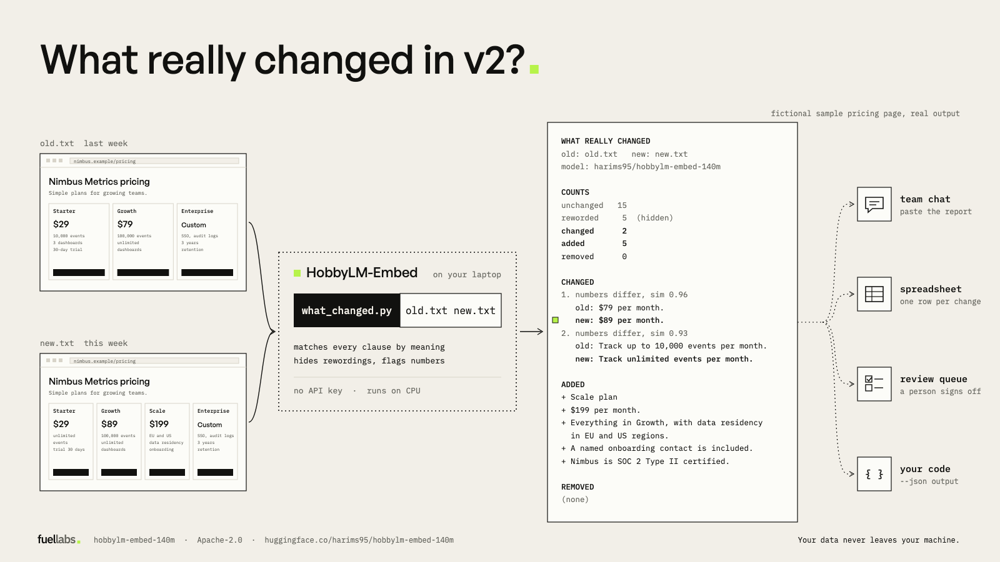

[](https://colab.research.google.com/github/fuellabs-ai/cookbooks/blob/main/what-changed/walkthrough.ipynb)

# What really changed in v2?



For marketers, store owners and account managers: compare two versions of a document and see only what changed in meaning.

<sub>Embedding task: semantic similarity</sub>

## Who this is for

- A growth or product marketer compares a competitor's pricing page from last week to this week, worried a new tier or a quietly raised price slipped past them.
- A store owner compares a supplier spec sheet revision to revision, worried the material, the MOQ or the lead time changed without anyone saying so.
- An account manager compares a client proposal draft to draft, worried the scope or the payment terms moved between versions.
- A product manager compares label copy draft to final, worried a claim got stronger or a warning got dropped.
- Also useful for (no example files): a procurement lead comparing vendor contract renewals, worried terms changed while the document title stayed the same.
- Also useful for: a compliance analyst comparing policy updates, worried a "may" quietly became a "must".
- Also useful for: legal ops comparing terms of service versions, worried an old clause disappeared.
- Also useful for: a technical writer comparing two docs releases, worried something was removed without a note.

Word diffs show every edit. Most edits are noise. This recipe matches clauses
across two versions with embeddings, hides the harmless rewordings, and shows
only what changed in meaning: the new tier, the price change, the scope cut.

Model: `harims95/hobbylm-embed-140m` via Sentence Transformers
(`trust_remote_code=True`). Embeddings only, no LLM. Clauses are embedded as
plain text with no query/passage prompts, because this is a similarity job,
not a search job. Vectors come out normalized, so similarity is a dot product.

Every file under `examples/` is sample data written for this recipe, with
fictional companies. Nothing here describes a real product or contract.

## The four example pairs

| Role | Hook |
|---|---|
| `gtm_pricing_page` | A competitor refreshed their pricing page: new tier, price up, event cap gone, SOC 2 claim added, and 5 sentences that just got shuffled. |
| `ecommerce_supplier_spec` | Supplier spec rev 1 vs rev 2: new lid material, taller bottle, lower MOQ, longer lead time, and rows that mean the same thing in different words. |
| `sales_proposal_v7` | Proposal v6 vs v7: a phase cut, payment terms flipped, a new deliverable, and 4 clauses that only moved words around. |
| `npd_product_brief` | Label copy draft vs final: the calorie claim moved, chia seeds appeared, a facility warning came out, and 3 lines were reworded for the lawyer. |

Each pair carries at least 3 pure rewordings so the demo shows the point:
those should never reach the report.

## Quickstart

```
pip install sentence-transformers
python what_changed.py examples/gtm_pricing_page/old.txt examples/gtm_pricing_page/new.txt
python what_changed.py examples/npd_product_brief/old.txt examples/npd_product_brief/new.txt --show-all
python what_changed.py --hard-cases examples/npd_product_brief/hard_cases.csv
```

Flags:

```
--threshold 0.85       similarity above which a pair counts as Reworded
--floor     0.74       similarity below which a clause counts as Added/Removed
--show-all             also print Unchanged and Reworded clauses
--code                 code/config mode: split by line only, any text change
                       on a non-comment line counts as Changed
--ignore-format        with --code: normalise quote style and whitespace and
                       join lines into balanced statements, so pure
                       reformatting is not reported
--sql-check DB_FILE    run matched SQL SELECT pairs against a SQLite database
                       and report same rows or different rows
--claim-words A,B,C    replace the built-in risky-phrase list
--no-claim-check       turn the claim-words check off
--json                 machine-readable output
--model                default: harims95/hobbylm-embed-140m
```

`walkthrough.ipynb` is the same story as an executed notebook, with outputs,
hard-case accuracy and the floor test reproduced end to end.

## Code and config files

Prose mode hides a text change when the two lines score as near duplicates,
because in marketing copy a rewording is usually harmless. In code and config
files it never is: `'debug' => false,` becoming `'debug' => true,` barely moves
the embedding, so prose mode files it under Reworded and hides it. Pass
`--code` when you compare code, config or SQL. The script then splits by line
only (no sentence splitting), matches lines with the same embedding matcher,
and labels any text change on a non-comment line as Changed, showing the
differing tokens. Comments keep the prose logic, because there a rewording
really is harmless: a line counts as a comment when it starts with //, #, --,
/*, *, */ or |, the last one covering the docblock-style comment boxes that
Laravel and similar PHP config files draw. Identical lines are matched case
sensitively: `TRUE` and `true` are not the same line.

A formatting sweep can flood a code-mode report, because a quote or a line
wrap is a text change. Pass `--ignore-format` when a reformat landed together
with real changes: quote style and whitespace are normalised before
comparing, and lines are joined into one logical statement until brackets and
parentheses balance, so a call that was rewrapped across several lines
compares as a single clause. Pure reformatting then drops out of the report;
what is left is real changes plus formatting that changed punctuation, such
as implicit string concatenation or a trailing comma that moved.

Lines that only moved position are never reported: matching is by content,
not order. Shuffle a config and `--code` shows nothing; rename a key and it
pairs with its own old line as one Changed pair. `tests/test_reorder.py`
checks this on a real Laravel config file.

For SQL there is `--sql-check DB_FILE`: for every matched pair whose old and
new sides both look like SELECT queries, the script runs both against the
given SQLite database and reports `same rows` or `different rows` under the
pair. A Changed label with `same rows` is a rewrite that returns the same
result, such as `IN (...)` becoming an OR chain. The database needs the
schema locally; rows are compared as a set, so row order does not count.
`tests/test_sql_check.py` runs four equivalence pairs against it.

The two example pairs under `examples/php_config/` and `examples/sql_migration/`
show it on a PHP config file and a SQL migration. Like everything under
`examples/` they are fictional sample data written for this recipe; they do not
describe a real service or database.

What prose mode does with the four dangerous lines, against what code mode does
(similarity is the real score from a run on these examples):

| old | new | similarity | prose mode | code mode |
|---|---|---|---|---|
| `'debug' => false,` -> `'debug' => true,` | 0.98 | Reworded, hidden | Changed: false -> true |
| `... ON DELETE CASCADE,` -> `... ON DELETE SET NULL,` | 0.93 | Reworded, hidden | Changed: CASCADE -> SET NULL |
| `status VARCHAR(20) DEFAULT 'active',` -> `... DEFAULT 'pending',` | 0.91 | Reworded, hidden | Changed: 'active' -> 'pending' |
| `'ssl_mode' => 'require',` -> `'ssl_mode' => 'prefer',` | 0.88 | Reworded, hidden | Changed: 'require' -> 'prefer' |

Code mode keeps every check prose mode already had: numbers still force Changed
(timeout 30 -> 60, credit_limit 1000.00 -> 500.00), a removed `NOT NULL` is a
claim-word change, and unmatched lines are Added or Removed as before.

Real output, pasted from a run
(`python what_changed.py examples/php_config/old.php examples/php_config/new.php --code --show-all`):

```
WHAT REALLY CHANGED
old: examples/php_config/old.php
new: examples/php_config/new.php
model: harims95/hobbylm-embed-140m | reword threshold 0.85 | related floor 0.74

COUNTS
unchanged   11
reworded     1
changed      4
added        1
removed      0

CHANGED
1. [text differs (false -> true), sim 0.98]
   old: 'debug' => false,
   new: 'debug' => true,
2. [numbers/dates differ (old: 30, | new: 60,), sim 0.94]
   old: 'timeout' => 30,
   new: 'timeout' => 60,
3. [text differs ('require' -> 'prefer'), sim 0.88]
   old: 'ssl_mode' => 'require',
   new: 'ssl_mode' => 'prefer',
4. [text differs ('retry_attempts' -> 'max_retries'), sim 0.79]
   old: 'retry_attempts' => 3,
   new: 'max_retries' => 3,

ADDED
+ 'read_replica' => env('DB_REPLICA_HOST'),

REMOVED
(none)

REWORDED
1. [sim 0.97]
   old: // Database settings for the orders service
   new: // Database configuration for the orders service

UNCHANGED
1. <?php
2. return [
3. 'default' => 'mysql',
4. 'host' => env('DB_HOST', '127.0.0.1'),
5. 'port' => 3306,
6. 'database' => 'orders',
7. 'charset' => 'utf8mb4',
8. 'pool_size' => 10,
9. 'strict' => true,
10. 'log_queries' => false,
11. ];
```

Real output, pasted from a run
(`python what_changed.py examples/sql_migration/old.sql examples/sql_migration/new.sql --code --show-all`):

```
WHAT REALLY CHANGED
old: examples/sql_migration/old.sql
new: examples/sql_migration/new.sql
model: harims95/hobbylm-embed-140m | reword threshold 0.85 | related floor 0.74

COUNTS
unchanged   10
reworded     1
changed      5
added        1
removed      0

CHANGED
1. [numbers/dates differ (old: 1000.00 | new: 500.00), sim 0.99]
   old: credit_limit DECIMAL(10,2) DEFAULT 1000.00,
   new: credit_limit DECIMAL(10,2) DEFAULT 500.00,
2. [numbers/dates differ (old: 255 | new: 320), sim 0.97]
   old: email VARCHAR(255) NOT NULL UNIQUE,
   new: email VARCHAR(320) NOT NULL UNIQUE,
3. [text differs (CASCADE -> SET NULL), sim 0.93]
   old: customer_id BIGINT REFERENCES customers(id) ON DELETE CASCADE,
   new: customer_id BIGINT REFERENCES customers(id) ON DELETE SET NULL,
4. [text differs ('active' -> 'pending'), sim 0.91]
   old: status VARCHAR(20) DEFAULT 'active',
   new: status VARCHAR(20) DEFAULT 'pending',
5. [claim words differ (old: negation | new: none), sim 0.91]
   old: name VARCHAR(255) NOT NULL,
   new: name VARCHAR(255),

ADDED
+ CREATE INDEX idx_orders_customer ON orders(customer_id);

REMOVED
(none)

REWORDED
1. [sim 0.95]
   old: -- Create the customers table
   new: -- Creates the customers table

UNCHANGED
1. CREATE TABLE customers (
2. id BIGINT PRIMARY KEY,
3. phone VARCHAR(20),
4. created_at TIMESTAMP DEFAULT CURRENT_TIMESTAMP
5. );
6. CREATE TABLE orders (
7. id BIGINT PRIMARY KEY,
8. total DECIMAL(10,2) NOT NULL
9. );
10. CREATE INDEX idx_customers_email ON customers(email);
```

## How it works, in plain words

1. **Split into clauses.** Lines, bullet markers and sentence boundaries. Short
   clauses match far better than paragraphs, and the model reads at most 1,024
   tokens per clause.
2. **Embed every clause.** Plain text, no prompts. The model returns 512
   dimensions per clause, already unit length.
3. **Match.** Identical text is Unchanged, no model needed. Everything else is
   matched greedily: the highest-scoring old-new pair is locked in, then the
   next, and so on.
4. **Check the pair for evidence of a meaning change.**
   - Numbers, prices, dates, percentages or durations differ: **Changed**,
     whatever the score says. Embeddings score "30 days" vs "60 days" at 0.989,
     which is why this check exists.
   - A risky claim word is added, removed or swapped: **Changed**, whatever the
     score says. The built-in list: may contain, contains, free, guaranteed,
     up to, at least, unlimited, high in, source of, certified, plus negations
     (not, no, no longer, without). Negations collapse into one class, so
     "no X" -> "without X" stays a rewording while "not included" ->
     "included" does not. Override or replace the list with --claim-words.
5. **Label.**
   - Same text: **Unchanged**.
   - Score at or above 0.85, with no evidence check firing: **Reworded**,
     hidden by default.
   - Related but below 0.85: **Changed**, old vs new shown side by side, and
     only when each clause is the other's overall nearest match across the whole
     other document. Without that rule, two unrelated leftovers grab each
     other and a removed clause shows up as a fake Changed pair.
   - No partner above 0.74: **Added** or **Removed**.
6. **Report.** Counts per label, then only Changed, Added and Removed.

### Why 0.85

Every matched pair across the four examples, sorted by similarity (the full
table is in the notebook):

```
0.988  changed   Payment terms 50%/50% -> 40%/60% (numbers differ)
0.982  reworded  Setup takes less than 15 minutes. -> Setup takes under 15 minutes.
0.975  reworded  Certifications: FDA food contact compliant -> compliant with FDA food contact requirements
0.975  reworded  8 g of protein per 55 g serving. -> Each 55 g serving has 8 g of protein.
0.971  changed   Dimensions 26.5 cm -> 27.5 cm (numbers differ)
0.968  changed   Lead time 45 days -> 60 days (numbers differ)
...
0.944  reworded  Colors available: slate, moss, sand -> Available colors: sand, slate and moss
0.926  changed   Care: ...do not use in a microwave -> keep away from microwave ovens (negation lost)
0.903  reworded  Travel costs billed at cost, capped at $2,000. -> Travel expenses passed through at cost...
0.783  changed   Lid material: polypropylene, BPA free -> bamboo (free disappears)
```

The pure rewordings land between 0.903 and 0.982. Meaning changes are forced by
the number and claim-words checks, whatever their score, so the threshold only
has to sort word-level noise. 0.85 was picked as the midpoint of the gap
measured before the claim-words check existed (lowest rewording 0.903, highest
non-numeric meaning change 0.783) and it still separates every pair in these
four documents correctly. Raising it to 0.95 surfaces the harmless rewordings
as Changed; both effects are shown with real counts in the notebook.

## Hard cases: accuracy before and after the claim-words check

Each role folder carries `hard_cases.csv` with 9, 8, 8 and 8 pairs written to
be difficult on purpose: claim-strength changes with no number ("High in
fiber." vs "Good source of fiber.", "Contains BPA." vs "BPA free.",
"guaranteed" vs "usually", "up to" vs "at least", "unlimited" vs limits),
negations ("not included" vs "included", "Not dishwasher safe." vs "Dishwasher
safe.", "Contains no artificial sweeteners." vs "Contains artificial
sweeteners."), and 10 removed sentences. They were written once and never
reworded after measuring. Expected labels: changed or removed.

| Role | Without claim check | With claim check |
|---|---|---|
| `gtm_pricing_page` | 4/9 (44%) | 8/9 (89%) |
| `ecommerce_supplier_spec` | 3/8 (38%) | 7/8 (88%) |
| `sales_proposal_v7` | 3/8 (38%) | 7/8 (88%) |
| `npd_product_brief` | 4/8 (50%) | 8/8 (100%) |
| **Total** | **14/33 (42%)** | **30/33 (91%)** |

The claim-word list was chosen with these cases in view; expect lower accuracy
on your own documents, and use --show-all for high-stakes ones.

The 3 remaining misses are all the same shape: a condition quietly narrows with
no number and no claim word from the list ("Free migration is included on every
plan." vs "...on annual plans.", "Hand wash only." vs "Hand wash recommended.",
"Free onboarding workshop included." vs "...for longer engagements."). They
score 0.91 to 0.96 and land in the hidden Reworded bucket. Add your own risky
phrases with --claim-words when a document type has them.

The claim-words check also touched the clean examples: the supplier care line
("do not use in a microwave" -> "keep away from microwave ovens") lost its
"not", so it now shows as Changed. That is the check doing what it is asked to
do, and it is the cost of running it: rewordings that keep their negation words
("No credit card required." -> "Credit card not needed.") still hide, this one
does not. Clean-example counts after the change: supplier spec 5 changed / 3
reworded; the other three examples are unchanged.

## Removed clauses vs the floor

Test: each of the 10 removed clauses from the hard cases is appended to its
role's old.txt and pushed through the real pipeline against that role's
new.txt. 5 of the 10 have a raw max similarity at or above the floor, which is
where a removed clause can get wrongly grabbed:

```
role                       max sim   in-doc label   clause
ecommerce_supplier_spec     0.792    removed        'Sample units available on request.'
ecommerce_supplier_spec     0.711    removed        'Spares kit available for order.'
gtm_pricing_page            0.747    removed        'Live chat support is available in English.'
gtm_pricing_page            0.744    removed        'Prices exclude local taxes.'
gtm_pricing_page            0.718    removed        'We never sell customer data.'
npd_product_brief           1.000    removed        'Made in a facility that processes tree nuts.'
npd_product_brief           0.720    removed        'Refrigerate after opening.'
sales_proposal_v7           0.828    removed        'The pilot covers 2 product categories.'
sales_proposal_v7           0.727    removed        'References from 3 retail clients available...'
sales_proposal_v7           0.769    removed        'A dedicated Slack channel is included.'

result: 10/10 shown as Removed, 0 wrongly matched
```

Before the mutual-nearest matching rule, 1 of the 10 failed: "A dedicated Slack
channel is included." grabbed the unrelated leftover "Also included: an
executive dashboard..." at 0.769 and showed up as a fake Changed pair. The fix:
below the reword threshold, a pair is only allowed when each clause is the
other's overall nearest match across the whole other document. With that rule all
10 stay Removed, and the one true low-similarity pair in the clean examples
(the lid material swap at 0.783) still pairs, because there each side's overall
nearest match really is the other. The floor stays at 0.74: raising it to 0.78 would
push the lid pair into Added, which is a worse error than the one the rule
fixes.

## Expected output

Numbers pasted from a real run on CPU (model revision `ea708cee107818fa0c1871eebd26d82a1e3fb1aa`, sentence-transformers 6.3.0):

Document pairs (`python what_changed.py examples/<role>/old.txt examples/<role>/new.txt`):

```
gtm_pricing_page          unchanged 15, reworded 5, changed 2, added 5, removed 0
ecommerce_supplier_spec   unchanged  7, reworded 3, changed 5, added 0, removed 0
sales_proposal_v7         unchanged 11, reworded 4, changed 2, added 1, removed 1
npd_product_brief         unchanged 11, reworded 3, changed 1, added 1, removed 1
```

Hard cases (`python what_changed.py --hard-cases examples/<role>/hard_cases.csv`):

```
                          with claim check   without claim check
gtm_pricing_page          8/9 (89%)          4/9 (44%)
ecommerce_supplier_spec   7/8 (88%)          3/8 (38%)
sales_proposal_v7         7/8 (88%)          3/8 (38%)
npd_product_brief         8/8 (100%)         4/8 (50%)
total                     30/33 (91%)        14/33 (42%)
```

Removed-clause floor test (each removed clause from the hard cases appended
to its role's old.txt and pushed through the pipeline):

```
result: 10/10 shown as Removed, 0 wrongly matched
```

If your counts differ, check the model revision and the sentence-transformers
version before trusting your own counts; embeddings are not bit-exact across
versions.

## Limits

- **The evidence checks only see what they list.** A condition that narrows
  with no number and no claim word still hides, as the 3 hard-case misses show.
  Use --show-all and skim the Reworded list when a document is high stakes.
  This is a screening pass, not a sign-off.
- **The fiber case is now caught, but only because the words are listed.**
  "High in fiber." vs "Good source of fiber." scores 0.909; the claim-words
  check catches it because "high in" and "source of" are on the list. A claim
  strength change outside the list hides exactly the same way. --show-all is
  the fix.
- **Claim words are tuned for offers, specs, proposals and label copy.** Your
  domain may need different risky phrases (--claim-words).
- **The number check reads "May" as the month**, so "may contain" also trips
  it. The accident is harmless here: a permission word appearing or vanishing
  is usually a real change.
- **Clause splitting is line and sentence based.** Bullet-style documents split
  cleanly. A wall of prose may split at odd places, and two clauses that share
  one idea can end up matched to each other's neighbors.
- **Code mode comment detection is prefix based.** With --code a line counts as
  a comment when it starts with //, #, --, /*, *, */ or |. A block comment body
  that does not start with one of those markers counts as code, so a text
  change inside it shows as Changed. That is the safe direction: code mode
  prefers a false alarm over a hidden change. --ignore-format trades some of
  that safety for quiet: quote style is normalised, so a change that is only
  quote marks hides too.
- **Statement joining is bracket counting.** --ignore-format joins lines
  until brackets balance, and brackets inside string literals count, so a
  string that contains an unmatched bracket skews the grouping. A file that
  is one balanced expression from top to bottom (a PHP config's return
  array) joins into a single statement; for PHP-style configs use plain
  --code instead.
- **--sql-check runs your queries.** Both sides of a matched pair are
  executed against the database you point at. Point it at a copy, never at
  a production database, and expect a SELECT-only script: pairs that are
  not SELECT queries get no verdict.
- **512 tokens per clause by default, up to 2,048 if you raise the limit.**
  Longer clauses are truncated by the model. The
  script prints a warning to stderr when a clause exceeds the limit.
- **English only.** The thresholds were checked on English sample data and
  nothing else.
- **Greedy matching is order dependent.** When two clauses want the same
  partner, the higher score wins and the loser can fall through to Added or
  Removed.
- **The threshold is document dependent.** 0.85 was picked on these four pairs.
  If your documents are formal contract language or chatty marketing copy,
  check the gap yourself with --show-all before trusting the default.

## Real output for each example

Run with `python what_changed.py examples/<role>/old.txt examples/<role>/new.txt`.
Outputs below are pasted from real runs (model download happened on run).

### gtm_pricing_page

```
WHAT REALLY CHANGED
old: examples/gtm_pricing_page/old.txt
new: examples/gtm_pricing_page/new.txt
model: harims95/hobbylm-embed-140m | reword threshold 0.85 | related floor 0.74

COUNTS
unchanged   15
reworded     5  (hidden, run with --show-all to see them)
changed      2
added        5
removed      0

CHANGED
1. [numbers/dates differ (old: $79 | new: $89), sim 0.96]
   old: $79 per month.
   new: $89 per month.
2. [numbers/dates differ (old: 10,000 | new: none), sim 0.93]
   old: Track up to 10,000 events per month.
   new: Track unlimited events per month.

ADDED
+ Scale plan
+ $199 per month.
+ Everything in Growth, with data residency in EU and US regions.
+ A named onboarding contact is included.
+ Nimbus is SOC 2 Type II certified.

REMOVED
(none)
```

### ecommerce_supplier_spec

```
WHAT REALLY CHANGED
old: examples/ecommerce_supplier_spec/old.txt
new: examples/ecommerce_supplier_spec/new.txt
model: harims95/hobbylm-embed-140m | reword threshold 0.85 | related floor 0.74

COUNTS
unchanged    7
reworded     3  (hidden, run with --show-all to see them)
changed      5
added        0
removed      0

CHANGED
1. [numbers/dates differ (old: 26.5 | new: 27.5), sim 0.97]
   old: Dimensions: 26.5 cm tall, 7.2 cm diameter
   new: Dimensions: 27.5 cm tall, 7.2 cm diameter
2. [numbers/dates differ (old: 45 | new: 60), sim 0.97]
   old: Lead time: 45 days from confirmed purchase order
   new: Lead time: 60 days from confirmed purchase order
3. [numbers/dates differ (old: 500 | new: 250), sim 0.95]
   old: Minimum order quantity: 500 units
   new: Minimum order quantity: 250 units
4. [claim words differ (old: negation | new: none), sim 0.93]
   old: Care: hand wash only, do not use in a microwave
   new: Care instructions: hand wash only, keep away from microwave ovens
5. [claim words differ (old: free | new: none), sim 0.78]
   old: Lid material: polypropylene, BPA free
   new: Lid material: bamboo with a silicone gasket

ADDED
(none)

REMOVED
(none)
```

### sales_proposal_v7

```
WHAT REALLY CHANGED
old: examples/sales_proposal_v7/old.txt
new: examples/sales_proposal_v7/new.txt
model: harims95/hobbylm-embed-140m | reword threshold 0.85 | related floor 0.74

COUNTS
unchanged   11
reworded     4  (hidden, run with --show-all to see them)
changed      2
added        1
removed      1

CHANGED
1. [numbers/dates differ (old: 50%, 50% | new: 40%, 60%), sim 0.99]
   old: Payment terms: 50% upfront, 50% on final delivery.
   new: Payment terms: 40% upfront, 60% on final delivery.
2. [numbers/dates differ (old: 2 | new: none), sim 0.97]
   old: Deliverables: audit report, pilot model, rollout playbook, 2 training sessions.
   new: Deliverables: audit report, pilot model, rollout playbook.

ADDED
+ Also included: an executive dashboard for weekly forecast review, delivered with the pilot model.

REMOVED
- Phase 3: rollout support and training for the merchandising team, 4 weeks.
```

### npd_product_brief

```
WHAT REALLY CHANGED
old: examples/npd_product_brief/old.txt
new: examples/npd_product_brief/new.txt
model: harims95/hobbylm-embed-140m | reword threshold 0.85 | related floor 0.74

COUNTS
unchanged   11
reworded     3  (hidden, run with --show-all to see them)
changed      1
added        1
removed      1

CHANGED
1. [numbers/dates differ (old: 190 | new: 170), sim 0.96]
   old: 190 calories per serving.
   new: 170 calories per serving.

ADDED
+ Now with chia seeds.

REMOVED
- Made in a facility that processes tree nuts.
```

### Hard cases, pasted from a real run

`python what_changed.py --hard-cases examples/npd_product_brief/hard_cases.csv`

```
HARD CASES: examples/npd_product_brief/hard_cases.csv
1. [ok  ] expected changed, predicted changed (sim 0.91, claim words differ (old: high in | new: source of))
   old: High in fiber.
   new: Good source of fiber.
2. [ok  ] expected changed, predicted changed (sim 0.92, numbers/dates differ (old: none | new: May))
   old: Contains peanuts.
   new: May contain peanuts.
3. [ok  ] expected changed, predicted changed (sim 0.95, claim words differ (old: negation | new: none))
   old: Contains no artificial sweeteners.
   new: Contains artificial sweeteners.
4. [ok  ] expected changed, predicted changed (sim 0.86, numbers/dates differ (old: none | new: May))
   old: Palm oil free.
   new: May contain palm oil.
5. [ok  ] expected changed, predicted changed (sim 0.85, claim words differ (old: certified | new: none))
   old: Certified organic by the supplier.
   new: Made with organic ingredients.
6. [ok  ] expected changed, predicted changed (sim 0.98, claim words differ (old: up to | new: none))
   old: Provides up to 8 g of protein per serving.
   new: Provides 8 g of protein per serving.
7. [ok  ] expected removed, predicted removed (no close match in new)
   old: Made in a facility that processes tree nuts.
   new: (empty, clause removed)
8. [ok  ] expected removed, predicted removed (no close match in new)
   old: Refrigerate after opening.
   new: (empty, clause removed)
accuracy: 8/8 = 100%
```
